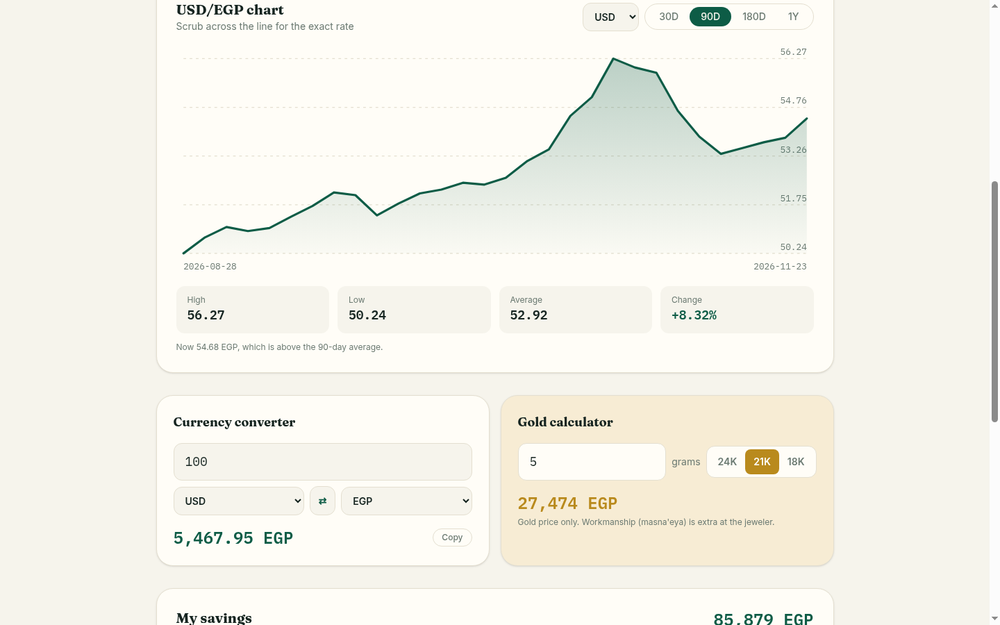

# EGP Tracker

Live dollar and gold prices in Egypt: USD/EGP and EUR/EGP rates, gold per gram by karat (24K, 21K, 18K), a scrubbable 90-day chart, and two quick converters - currency and gold grams.

**Live demo:** https://malakmo7amed309.github.io/egp-tracker/

## Features

- Live USD, EUR and SAR rates against the Egyptian pound, and gold per gram in 24K, 21K and 18K.
- A scrubbable chart, hand-rolled in SVG with no chart library. Pick the currency (8 of them) and the range (30D, 90D, 180D, 1Y), with high, low, average and change underneath.
- Currency converter between any two of EGP and 8 currencies, with swap and copy.
- Gold calculator by karat. 21K is the default because that is the Egyptian standard.
- **My savings**: add dollars, euros or grams of gold, optionally what you paid, and see today's value and profit in EGP.
- **Price alerts**: set a dollar rate to watch (above or below). Checked on every refresh while the page is open.
- Auto-refresh every 5 minutes. If the rates service is down, the last saved numbers stay on screen with a note.
- Everything you enter is saved in your browser only (localStorage).

## Stack

- React + Vite (single-file build)
- Tailwind CSS v4
- Data: open currency-api daily snapshots (fawazahmed0/currency-api) and the gold-api.com live spot
- Past daily snapshots are cached in localStorage, so charts reload fast
- Scoring and money maths live in `src/lib/calc.js` with unit tests

## Run it locally

```bash
npm install
npm run dev
npm test
```

`npm run build` produces the single-file build in `dist/`, which is what `docs/` serves through GitHub Pages.

## Screenshot


