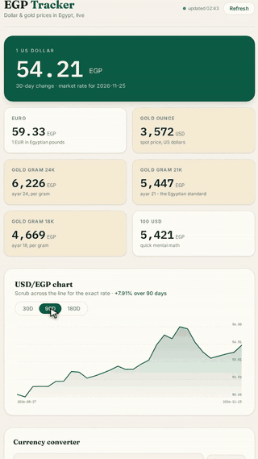

# EGP Tracker

Live dollar and gold prices in Egypt: USD/EGP and EUR/EGP rates, gold per gram by karat (24K, 21K, 18K), a scrubbable 90-day chart, and two quick converters - currency and gold grams.

**Live demo:** https://malakmo7amed309.github.io/egp-tracker/

## Standout feature

The chart is hand-rolled SVG - no chart library. Hover or touch-drag anywhere on it and a crosshair snaps to each daily point with the exact rate and date. The gold side is just as hands-on: it prices grams by *ayar* (karat) the way Egyptian jewelers actually quote, with 21K as the default because that is the Egyptian standard.

## Stack

- React + Vite (single-file build)
- Tailwind CSS v4
- Data: open currency-api daily snapshots (fawazahmed0/currency-api) + gold-api.com live spot
- Rates cached in localStorage for 10 minutes so revisits load instantly

## Run it locally

```bash
npm install
npm run dev
```

`npm run build` produces the single-file build in `dist/`, which is what `docs/` serves through GitHub Pages.

## Screenshot


